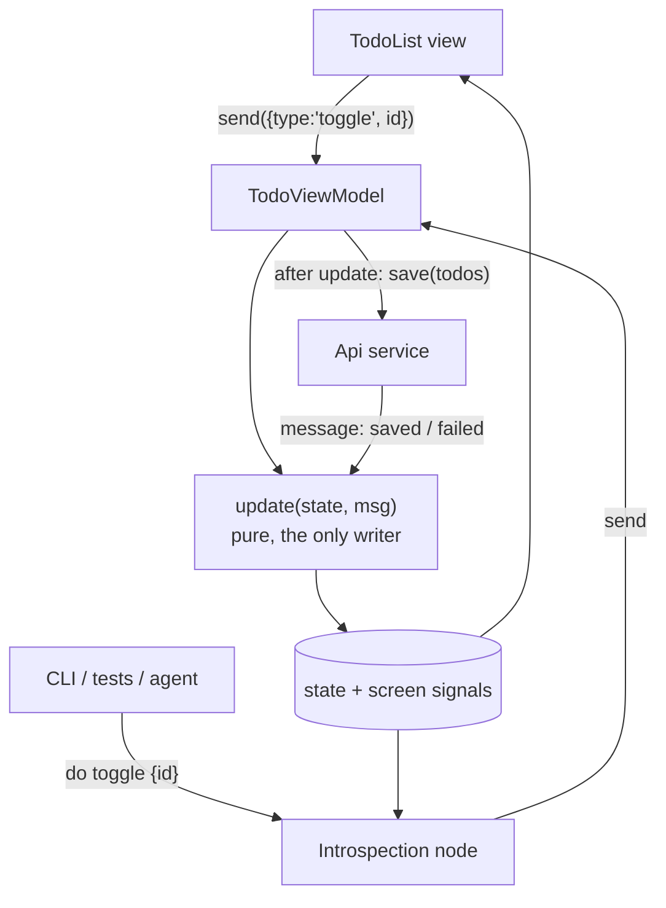
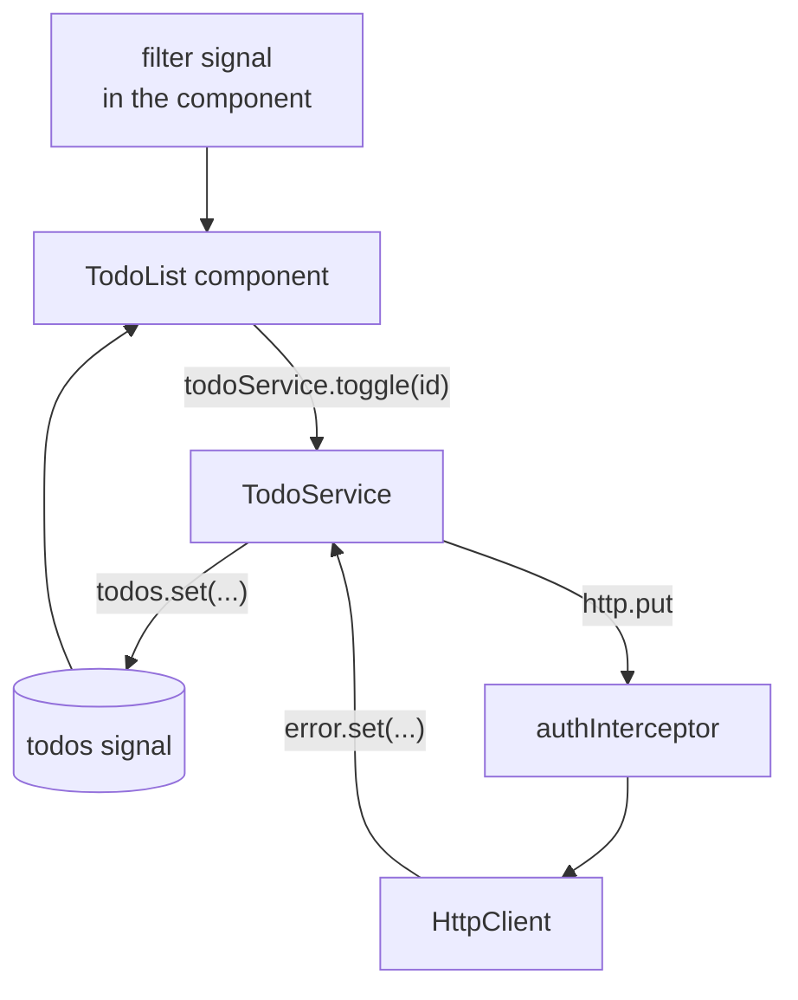

# Reflex vs classic Angular: a Todo app, two ways

The same Todo app (sign-in, per-user todos) built twice on Angular 22, sharing one backend.
For how the two compare, with measurements and the bugs each approach caught, see
[Reflex vs classic: analysis](#reflex-vs-classic-analysis).

```
reflex/    Angular app following Shopify's Reflex pattern (https://shopify.engineering/reflex)
  src/core/  UI-free ViewModels, introspection, Api client + fixtures, behavior tests
  src/app/   Angular views, routes, browser adapters
  cli/       headless ls/do driver
classic/   the same app written the conventional Angular way
  src/app/   services, interceptor, guards, components
backend/   Express 5 + SQLite API used by both apps
```

Each folder is a standalone project with its own `package.json`, lockfile and config.
Only repo-wide editor/format settings (`.editorconfig`, `.prettierrc`, `.gitignore`) live at the root.

## Run

Start the backend first, each in its own terminal from the repo root; both apps proxy `/api` to it (`proxy.conf.json` in each app).

```bash
cd backend && npm install && npm start    # http://localhost:3000 (SQLite file backend/todos.db; DB_PATH, PORT to override)
cd reflex  && npm install && npm start    # http://localhost:4200
cd classic && npm install && npm start    # http://localhost:4300
```

Every project has `npm test`; `reflex` and `backend` also have `npm run typecheck`
(Node runs their `.ts` files by stripping types, so types are checked separately).

`reflex` and `classic` also have `npm run e2e` (Playwright). It starts its own backend with an
in-memory database and its own dev server on separate ports (reflex 4201/3100, classic 4301/3101),
so running dev servers and `backend/todos.db` are untouched. Needs `npm install` in `backend/` and
a Playwright browser (`npx playwright install chromium`).

## `reflex/`

The app logic can be built, tested and driven without rendering any UI.

| Reflex idea | Here |
|---|---|
| Core module with no UI | `src/core/`: plain TS plus Angular signals only, runs in Node |
| Strict ViewModel contract | `ViewModel<S, A, M>`: `send(action)` in, `state` signal out, one pure `update()` |
| Services injected through the constructor | `Api` interface: `httpApi()` in the browser, `memoryApi()` fixture in tests and the CLI |
| Introspection node | `{ name, state, actions, child? }` per screen, JSON input validated |
| Object tree, focus, lent actions | `AppViewModel` (root, owns the session) → `SignIn` or `TodoList`; root lends `signOut` |
| CLI (`ls` / `do`) | `cli/reflex.ts`, headless, with a zero-network guard |
| Grey-box behavior tests | `src/core/*.behavior.spec.ts` drive the app only through `ls`/`do` |

```bash
cd reflex
npm run cli                            # in-memory backend, one command per line:
#   ls
#   do register {"username":"ann","password":"secret123"}
#   do add {"title":"Buy milk"}
npm run cli -- http://localhost:3000   # same, against the real backend
```

In a dev build, the live app exposes the same surface in the browser console:
`reflex.ls()` and `reflex.do('add', { title: 'x' })`.

### Testing: share the test, not the code

Following the article, user journeys are written once (`src/core/journeys.ts`) against a tiny
framework-free SDK (`src/core/testing.ts`: `precondition` and `do`, which poll and fail with the last
state seen; no sleeps). They only see what the UI sees, the focused screen's state and actions.

| Layer | Runs the journeys against | Command |
|---|---|---|
| Behavior (wide middle) | real ViewModels + in-memory backend, network blocked, no browser | `npm test` |
| Live journeys (thin top) | the real dev build + real backend, through the `window.reflex` bridge | `npm run e2e` |
| UI wiring (one flow) | the real page: typing, clicking, rendering (`e2e/ui.spec.ts`) | `npm run e2e` |

Adding a journey to `journeys.ts` adds it to both the headless and the Playwright runs.

## `classic/`

`AuthService` / `TodoService` call `HttpClient` directly, an `authInterceptor` adds the token and handles 401,
guards protect the routes, `SignIn` uses reactive forms, and the filter lives in the component.
Tests mock HTTP with `HttpTestingController` and drive the DOM through `RouterTestingHarness`;
the Playwright suite (`e2e/todos.spec.ts`) drives the real page against a real backend.

```bash
npm test
```

## `backend/`

Express 5 + Node's built-in `node:sqlite`. Passwords are hashed with scrypt; sign-in returns a
random bearer token stored in a `sessions` table.

| Endpoint | |
|---|---|
| `POST /api/register`, `POST /api/sign-in` | `{username, password}` → `{token, username}` |
| `POST /api/sign-out`, `GET /api/me` | bearer token |
| `GET /api/todos`, `PUT /api/todos` | bearer token; PUT replaces the user's whole list |

```bash
npm test                # runs the real server in-process against an in-memory database
```

## Reflex vs classic: analysis

A close reading of the Reflex pattern, measured against the classic build of the same app. Both apps share
one backend, so every difference below comes from the frontend architecture.

### The short answer

- **Reflex buys testability and automation.** Every screen becomes a small state machine with a public,
  JSON-describable surface. That surface is the test API, the CLI and the agent API at once. Behavior tests run in
  milliseconds without a browser, and the same journey runs again on the real build.
- **Classic buys brevity and familiarity.** Services and components, written the way the Angular docs teach. It
  needs about 45% less app code, any Angular developer can read it, and it gets the HttpClient and forms
  ecosystem for free. Its cost lands in tests: almost every check has to go through the DOM.
- **When the price is worth it.** Reflex pays off when behavior is complex, tests must run fast and in large
  numbers, more than one client must behave the same, or an agent must operate the app. For a small CRUD app with
  one client, classic is the better trade.

### What Reflex actually is

Reflex is a pattern, not a library. The article lists four pillars, and only the last two are new:

- **A core with no UI.** ViewModels, services, navigation and the network client live in a module that imports
  nothing from the UI or the device. Hosts (the app, a CLI, a test) construct it and pass in platform services.
- **One ViewModel shape.** Actions go in through `send(action)`, state comes out, and a single
  `update(state, message)` is the only place state changes. Service results come back as internal messages
  through the same `update`.
- **Introspection.** Each ViewModel exposes a node: a stable `name`, its `state` as JSON, every `action` with an
  input schema, and an optional `child`. Following `child` finds the focused screen, and containers lend actions to
  it (a navigator lends `goBack`).
- **A protocol and a CLI.** `ls` prints the focused node and `do Action {json}` runs an action. Tests, the CLI and
  Shopify's in-app assistant all use this one surface.

The article's rules for nodes carry most of the weight: if a user can see it, it is in `state`; if a user can do
it, it is in `actions`; the node never repeats UI logic; and actions only go through `send`, so the protocol can do
nothing a person couldn't.

### How a click travels

Toggling a todo, traced through each app.

**Reflex**



**Classic**



In Reflex there is one entry point, used by the view and by everything else. In classic the filter state lives in
the component, so no test or tool can see it without rendering the page.

### Where it comes from

Reflex is The Elm Architecture applied per screen. Readers who know Redux, NgRx, MVI on Android or TCA on iOS will
recognize the ViewModel half. The new part is what Reflex does with the uniform shape.

| Idea | Prior art | What Reflex adds or changes |
|---|---|---|
| Actions in, state out, one reducer | Elm, Redux, NgRx, MVI, TCA | Scoped to one screen, not one global store. No library, just a base class. |
| Effects return as messages | Elm `Cmd`, NgRx Effects, TCA `Effect` | Kept informal. Services are called after `update`, and results come back as messages. |
| Inspectable state and actions | Redux DevTools | Adds an input schema per action and a focus tree, so a machine can operate the app, not only watch it. |
| Driving the app from tests | Page Objects, XCUITest, Espresso | Drives ViewModels, not widgets. Same test file on every platform, with no device needed. |
| Dependency inversion | Hexagonal architecture, ports and adapters | Fixtures replace only the edges, plus a guard that fails any test that touches the network. |

### Measured in this repo

Counts are non-blank, non-comment lines. Timings are from local runs on Apple silicon, Chromium headless.

| Measure | Reflex | Classic | Notes |
|---|---|---|---|
| App code, total | 600 | 332 | Reflex is 1.8×. Without the introspection layer it is 494, or 1.5×. |
| State and logic | 222 core + 74 api | 143 services + interceptor | Reflex adds action unions, message types and the dispatch plumbing. |
| Agent and test surface | 106 + 25 CLI | 0 | The introspection nodes and the headless CLI. Classic has no equivalent. |
| Views, routing, platform | 198 | 189 | Close. The templates are nearly identical. |
| Unit and behavior tests | 17 tests, 210 lines | 6 tests, 109 lines | Reflex tests need no DOM and no HTTP mocks. Classic tests need both. |
| Full journey, headless | 64 ms | n/a | Register, add, toggle, filter, clear, rename, sign out, sign in. Most of the time is the 20 ms poll interval. |
| Same journey, real build | 456 ms | ~800 ms | Reflex runs it through the `window.reflex` bridge. Classic runs it through the page. |
| E2E test code | 35 lines, 3 tests | 51 lines, 3 tests | Reflex journeys live in core (20 lines) and run in both suites. |
| Production JS, gzipped | 60.2 kB | 76.0 kB | Classic pays for HttpClient and reactive forms, not for its architecture. Reflex uses `fetch` and template refs. |

### What each approach caught, and missed

The most useful evidence is what actually broke while building the two apps.

- **Signing out lost the last todo** *(caught by a Reflex behavior test).* When saving became async, a Reflex
  journey failed: sign-out revoked the token before the queued save ran. The headless test reached this through
  the protocol, with no browser. The fix (flush saves, then revoke) was ported to classic, where a DOM test with
  mocked HTTP now guards it.
- **Typed credentials were wiped after navigation** *(caught by classic e2e).* Playwright filled the sign-in form
  about 8 ms before Angular's reactive form finished binding, and binding wrote the initial empty value over the
  input. Only a test that types into a real page finds this. Reflex's grey-box journeys skip the form, so by design
  they can never see this class of bug.
- **Edits made during the first load were overwritten, in both apps** *(caught by repeated e2e runs).* A todo
  added while `GET /api/todos` was in flight vanished when the load returned, yet its save still reached the
  server. A failed load was worse, because the next edit would have replaced the server's whole list. Both apps
  now refuse edits until the list has loaded: in Reflex the rule sits in `update`, in classic in the service's
  save path.
- **Signing straight back in showed a stale list, Reflex only** *(caught by repeated e2e runs).* Sign-out waited
  for queued saves, but signing in again didn't, so the new session loaded before the last saves landed. Classic
  never had this, because it shows the sign-in page only after its saves finish, while Reflex switches screens at
  once. The root ViewModel now delays the next load until earlier saves have landed.
- **A derived value was computed twice in Reflex** *(fixed).* `remaining` was computed in the introspection node
  and again in the view, so tests checked one copy while users saw another. The ViewModel now exposes one `screen`
  signal with derived values included, read by both.
- **The introspection code shipped to production** *(fixed).* The bridge was gated by `isDevMode()` at runtime, so
  its code stayed in the bundle. It now loads through a dynamic `import()` behind Angular's `ngDevMode` build flag.
  Production output contains none of it; dev builds load it as a 3.4 kB lazy chunk.
- **The router is a second source of truth** *(open).* The core decides which screen is focused, but Angular's
  router also owns the URL. Keeping them aligned takes an effect plus route guards. Deep links would need
  navigation state in the core, which means modeling routes twice.
- **Lent actions show up where they do nothing** *(open).* Following the no-conditionals rule, `signOut` is listed
  on the SignIn screen too, where `update` ignores it. The rule keeps nodes simple, but an agent reading `ls` sees
  an action that has no effect.

### The real costs of Reflex

**Every feature touches four places.** Adding "set a due date" means changing the action union, adding an
`update` case, adding a node entry with its input schema, and binding the view. Classic needs a service method and
a template binding. The node entry repeats the action type, which is why the article generates nodes from
annotations.

```ts
// Reflex: four edits
// 1. action union
| { type: 'setDue'; id: number; due: string }
// 2. update()
case 'setDue': return { ...state, todos: map(a.id, (t) => ({ ...t, due: a.due })) };
// 3. introspection node
setDue: { title: 'Set due date', input: { id: 'number', due: 'string' }, run: (i) => vm.send({ type: 'setDue', ... }) },
// 4. view
(change)="send({ type: 'setDue', id: t.id, due: $any($event.target).value })"
```

```ts
// Classic: two edits
// 1. TodoService
setDue(id: number, due: string) {
  this.save(this.todos().map((t) => (t.id === id ? { ...t, due } : t)));
}
// 2. template
(change)="todoService.setDue(t.id, $any($event.target).value)"
```

**Effects are imperative.** The reducer is pure, but here the effects run in `dispatch` overrides: saving after a
change, calling the API after a sign-in action. Elm and TCA return effects from the reducer as data, which lets a
test assert "this action requests a save" without running one. Reflex leaves this informal. That keeps it small,
but every effect is tested only through its outcome.

**Grey-box tests have blind spots.** The behavior tests can't see layout, styling, accessibility, focus handling
or a button wired to the wrong action. The article accepts this and keeps a thin layer of UI tests and screenshot
tests where pixels matter. This repo keeps one Playwright UI flow for the same reason, and the forms race above
shows why that layer can't go to zero.

**It works against Angular's grain.** Angular's DI only hands the root ViewModel to views, interceptors are
replaced by a hand-written `Api`, and the router has to follow the core. Teams lose some ecosystem help, and new
developers need to learn the house pattern before they can contribute.

### The real costs of classic

- **State is scattered.** It lives in services, component signals (the filter) and router guards. There is no
  single place to read what a screen shows or what it can do.
- **Tests are coupled to the DOM.** The unit tests drive templates and mock every HTTP request in order. A markup
  change can break a logic test, and each test costs more lines.
- **Timing becomes the test's problem.** E2E tests have to know when Angular has finished binding (the
  `ng-pristine` wait). Reflex tests poll on state, which is either right or wrong.
- **Automation means browser automation.** An agent can only operate the classic app through a browser, with
  selectors that change when the design does. In Reflex, `reflex.ls()` returns the screen as JSON.

### How each handles common changes

| Change | Reflex | Classic |
|---|---|---|
| Restyle the UI (done here: Tailwind) | Only templates and `styles.css` changed. Core and behavior tests untouched. | Templates changed. Unit tests survived because they select by `name` and `aria-label`, which stayed. |
| Add a feature | Four edits, one of them repetitive unless nodes are generated. | Two edits. |
| Swap the backend transport | Write another `Api` implementation. Tests keep using the fixture. | Edit services and interceptor, then update the HTTP expectations in tests. |
| Add a second client (mobile, desktop) | The article writes code per platform and shares only the tests. In TypeScript the core could also be shared as-is. | Logic is tied to Angular services, so it is rewritten or extracted first. |
| Let an agent operate the app | Already there: `ls`/`do`, schema-validated. | Needs browser automation and selectors. |
| Grow to hundreds of journeys | Headless runs stay in the tens of milliseconds each, in parallel. | Each journey needs a browser or a heavily mocked DOM test. |

### Choosing

**Pick Reflex** when the app has many states and edge cases, when behavior tests will number in the hundreds,
when several clients must behave the same, or when agents, assistants or scripted QA need to operate the app. The
fixed cost is a few hundred lines and a team convention. After that, each test is cheap.

**Pick classic** when the app is mostly forms over a backend, has one web client, and is maintained by a rotating
team that already knows Angular. A few DOM-level e2e tests cover it, and the extra layer would cost more than it
saves.

A middle path exists. Keeping classic services but moving each screen's logic into a pure reducer gets most of
the testability, and NgRx SignalStore with events comes close. What only Reflex gives is the introspection surface.
Adopt that part when you want agents or cross-client tests, not as a default.

### If you adopt it in Angular

1. Generate nodes from one typed action map (a schema library or a small codegen step), so actions are declared once.
2. Put derived values in ViewModel state, so the view and the node can't drift apart.
3. Return effects from `update` as data, so tests can assert intent without running it.
4. Load introspection through a dev-only dynamic import, so it never ships to production.
5. Treat the router as a projection of core navigation state, with one sync point.
6. Keep a thin layer of real-page tests for wiring, forms, focus and accessibility.
7. Run the live journeys repeatedly in CI (for example `--repeat-each`). Two of this repo's real bugs only showed up
   as intermittent failures.

*Sources: Shopify Engineering, ["Reflex"](https://shopify.engineering/reflex) (Nov 5, 2026), and the two
implementations in this repository. The article's own code samples were not available, so the TypeScript shapes
here are this repo's reading of its prose.*
